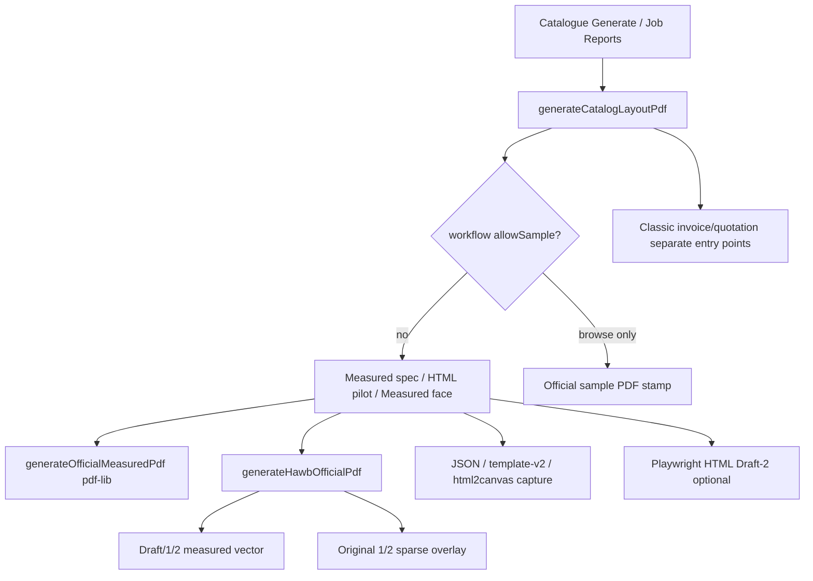

# Report Rendering Architecture Audit

**Mode:** READ ONLY — no template, layout JSON, or renderer changes.  
**Verified at:** 2026-11-26 (repo evidence).  
**Legend:** **Verified** = counted or read from source; **Assumption** = inference.

---

## 1. Executive architecture

Catalogue Generate funnels through `generateCatalogLayoutPdf` (`src/features/reports/utils/generateCatalogLayoutPdf.ts`). That function branches by code class and workflow:

1. Measured spec PDF (`tryMeasuredSpecPdf`) when a `reports/specs/<code>.json` path applies and sample browse is not allowed  
2. HTML/CSS pilots (`tryHtmlCssPilotPdf`) for selected pilots  
3. Official measured faces (`generateOfficialMeasuredPdf`) for codes in `measuredFaces.generated.ts` (except HBL Jasper pilot and official HAWB natives handled below)  
4. Reference-accurate dedicated builders (`generateReferenceAccuratePdf`) — 4 pilots  
5. HBL Jasper / HBL sample / HBL classic family paths  
6. HAWB Draft-2 Playwright print client (optional), then `generateHawbOfficialPdf` for the five official HAWB natives  
7. Template-v2 / JSON shell fallback (`resolveAnyFormatUiLayout` + JSON invoice-style painter)

**Verified:** Product Generate must not return Fresa CDN samples (`allowsFresaSamplePdf` / workflow gates). Samples are browse-only.

---

## 2. Entry points (verified)

| Entry | Path | Role |
|---|---|---|
| Catalogue Generate | `generateCatalogLayoutPdf.ts` | Universal catalogue router |
| Measured drawer | `templates/official/generateOfficialMeasuredPdf.ts` | pdf-lib vector from measured face |
| HAWB official | `templates/hawb/official/generateHawbOfficialPdf.ts` | Draft/1/2 measured; Original sparse |
| HAWB sparse | `templates/hawb/official/generateHawbSparsePdf.ts` | Preprinted-style data islands |
| Reference accurate | `templates/referenceAccurate/*` | Hand pilots |
| Playwright HAWB Draft-2 | `engines/pdf/playwrightHtml/hawbDraft2PrintClient.ts` | Local Chromium print when service up |
| Classic invoice | `features/invoices/utils/generateInvoicePdf.ts` | Preserved per MASTER_PROMPT |
| Classic quotation | `features/quotations/utils/generateQuotationPdf.ts` | Preserved |
| Spec render tooling | `tools/reports/render-spec.mjs` | Offline verify pipeline (not catalogue UI) |

UI openers (verified in PROGRESS repo map): Job Detail Reports, Shipment reports catalog, Quotation `buildCatalogHref`, Invoice Formats / Reports catalog → `/reports/dashboard` / `/reports/formats/:code`.

---

## 3. Libraries (verified from package.json)

| Library | Version | Use |
|---|---|---|
| `pdf-lib` | ^1.17.1 | Measured faces, sparse HAWB, branding stamps |
| `jspdf` | ^4.2.1 | Capture / legacy shells |
| `html2canvas` | ^1.4.1 | React face → raster (defect-prone for fidelity) |
| `playwright` | ^1.61.0 | Draft-2 HTML print pilot (dev/local) |
| `jsbarcode` | ^3.12.3 | CODE128 via `code128Vector.ts` |
| `qrcode` | ^1.5.4 | In package.json; **no imports found in report PDF drawers** (verified absence) |
| `pdfmake` | (invoice flow) | `flow/renderInvoiceFlowPdf.ts` Arimo VFS path |

Fonts (verified in measured path / PROGRESS): Arimo Regular+Bold embedded; Noto Naskh Arabic for Arabic variants; Helvetica/Arial metric substitutes — never copy Fresa embedded fonts (MASTER_PROMPT rule 9).

---

## 4. JSON layouts

**Verified:** Hundreds of codes resolve through shared UI layout stores (`has_json_layout=yes` on **928** format-map rows). Prior audit `src/features/reports/qa/REPORT_LAYOUT_DUPLICATION_AUDIT.md` documents shell aliasing (many codes → one JSON object).

**Assumption:** Exact unique JSON object count was not re-enumerated in this pass; treat JSON path as the dominant approximate renderer for codes without measured faces.

---

## 5. Tables, pagination, page geometry

| Concern | Evidence |
|---|---|
| Page size / orientation | Measured faces store `widthPt`/`heightPt`/`rotateDeg`; enrichment `page` schema A4 portrait/landscape |
| Rotation | Format-2 Tax Invoice India and peers use mediaBox + `page.setRotation` + content rotate (PROGRESS) |
| Pagination | Draft-1 multi-copy faces; Airway T&C append after HAWB; list/xlsx reports separate |
| Dynamic rows | Invoice flow modules + JSON painters; measured faces often stamp fixed fieldSlots (weak for long tables) |
| Barcode | `code128BitString` + pdf-lib rect bars; leftover sample barcodes called out historically on HBL |
| Logo | `resolveReportOrgChrome`, `drawOrgLogoInSlot`, brandingSlots.generated.ts (**392** slots) |

---

## 6. Representative execution traces (verified intent from code)

### A. Invoice with measured face (e.g. Format-4)
`generateCatalogLayoutPdf` → `isOfficialMeasuredNativeCode` → `generateOfficialMeasuredPdf` (lines/labels from face + org branding + fieldSlots).

### B. Ocean HBL with measured face
Same measured path; branding rules place logo/company in agent/carrier box, never shipper (PROGRESS / letterhead tests).

### C. HAWB Draft / Draft-1 / Draft-2
`isHawbOfficialNativeCode` → `generateHawbOfficialPdf` → `getOfficialMeasuredFace` → `mapHawbToOfficialFaceData` → `generateOfficialMeasuredPdf` + optional Airway T&C. Draft-2 may try Playwright first when service available.

### D. HAWB Original-1 / Original-2
`generateHawbSparsePdf` — sparse data stamps on 737×923 / 595×845 MediaBox (preprinted-style).

### E. JSON shell fallback (majority of catalogue)
No measured face / early paths miss → `resolveAnyFormatUiLayout` → JSON/React capture. Format-map: **538** `json_shell_fallback`.

### F. Classic invoice button
Bypasses catalogue measured path — `generateInvoicePdf.ts` (must remain until family accepted).

---

## 7. Defect-prone stages (verified root causes)

| Symptom | Root cause (evidence) |
|---|---|
| Overlapping text | Live stamps on uncleared sample glyphs; multi-line stamp reuse of last slot; wrong face on Originals historically |
| Clipping / spill | Party lines longer than slot width; missing wrap/cap; html2canvas scale artifacts |
| Wrong position | Misclassified fieldSlots (e.g. cargo in kg column); rotate-90 coord mistakes; wipe overlapping wrong bands |
| Empty / rough forms | Incomplete stamp chrome (agent/Issued-by/K/S); leftover demo AWB strips not matched by skip regex |
| Huge blurry PDFs | html2canvas raster path (~200MB, no extractable text) vs vector measured |
| Inconsistent styling | Multiple renderers (measured / JSON / capture / Playwright / classic) with different fonts and chrome |
| Pagination errors | Multi-page fixtures incomplete; T&C append inconsistent historically (now unified for HAWB five) |
| Green tests ≠ visual match | Many tests assert model mapping or evidence PDFs, not catalogue html2canvas/measured output users download |

---

## 8. What is *not* a single universal renderer yet

**Verified:** Despite measured promotion (~421 faces / 412 format-map measured path), **538** format-map rows still JSON-shell, **62** unmapped, **0** codes MASTER_PROMPT-`accepted`. Spec verify tooling (`tools/reports/full-run.mjs`, `verify-pool.mjs`, `diff-pilot.mjs`) exists for pinned PDFs but is not the catalogue Generate path and is not wired as a per-code CI gate for all 852.

---

## 9. Stale docs vs live code (cross-check)

| Claim | Live code |
|---|---|
| `HAWB_LOCK` in `officialFaceRegistry.ts` | **Absent** — five HAWB codes are in `MEASURED_OFFICIAL_FACES` |
| “HAWB stays on dense React only” comment in catalogue router | **Stale** — Draft/1/2 go measured via `generateHawbOfficialPdf`; Originals sparse |
| Format-map HAWB `json_shell_fallback` | **Stale** vs current Generate routing |
| PROGRESS “locked out of measured” | Historical; superseded by unlock |

---

## Assumptions

- Production Hostinger/Node deploy does not run the Vite Playwright Draft-2 print service (MASTER_PROMPT context); Draft-2 falls back to official generator.  
- Backend NestJS report packs are optional/additive and out of this frontend audit scope unless called from FE.
